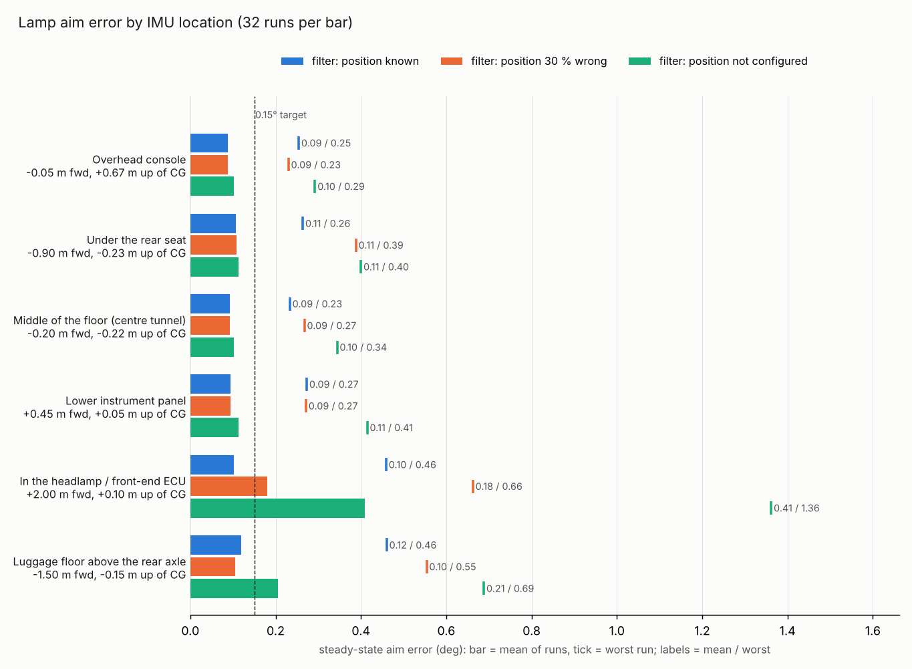

# Where to mount the IMU

`hal mount-study` runs the verification plant (`sim/halfcar.py`) with the IMU at
different places in the car and compares the lamp aim error. This page holds the
result for six locations on the reference sedan and what follows from it.

```bash
hal mount-study --list        # the locations and their coordinates
hal mount-study --seeds 4     # -> runs/mounting/report.md, report.json, mounting.png
```

The study is resumable: finished runs are stored in `runs/mounting/runs.jsonl`.

## 1. What the location changes

The accelerometers measure the motion of the point they sit at, not of the car.
With the IMU `x` ahead of and `z` above the body's pitch axis, and `d` ahead of
the rear axle, they see in addition:

| Term | Channel | When |
|---|---|---|
| `+x · pitch acceleration` | vertical | every acceleration change, every bump |
| `−z · pitch acceleration` | longitudinal | same |
| `−d · yaw rate²` | longitudinal | every turn, same sign left and right |
| `a_lat · rear side-slip angle` | longitudinal | every turn, same everywhere in the car |

The filter removes all four when it is told the position
(`fusion.imu_lever_x_m`, `imu_lever_z_m`, `imu_rear_axle_x_m`) and the vehicle's
side-slip gradient (`rear_slip_rad_per_ms2`). The two turning terms were added to
the plant and the filter for this study.

A rigid-body model cannot say how strongly a location vibrates, how well its
alignment holds, or how much its temperature moves. Section 4 shows what each of
these would cost; the values themselves must be measured on the body.

## 2. Set-up

Reference sedan: wheelbase 2.75 m, centre of gravity (CG) 1.25 m behind the front
axle and 0.55 m high. The coordinates are my estimates for a car of that size, on
the centre line. Replace them in `verify/mounting.py` (`LOCATIONS`) with the real
ones.

| Location | Fixed to | Behind front axle | Height | Ahead of CG | Above CG | Ahead of rear axle |
|---|---|---|---|---|---|---|
| Overhead console | roof header | 1.30 m | 1.22 m | −0.05 m | +0.67 m | 1.45 m |
| Under the rear seat | floor / rear cross-member | 2.15 m | 0.32 m | −0.90 m | −0.23 m | 0.60 m |
| Middle of the floor (centre tunnel) | tunnel | 1.45 m | 0.33 m | −0.20 m | −0.22 m | 1.30 m |
| Lower instrument panel | cross-car beam | 0.80 m | 0.60 m | +0.45 m | +0.05 m | 1.95 m |
| In the headlamp / front-end ECU | lamp housing | −0.75 m | 0.65 m | +2.00 m | +0.10 m | 3.50 m |
| Luggage floor above the rear axle | rear floor | 2.75 m | 0.40 m | −1.50 m | −0.15 m | 0.00 m |

Each location was driven through eight scenarios (`city_loaded`, `city_no_camera`,
`sporty_driving`, `rough_road`, `curvy_road`, `urban_turns`, `hill_route`,
`soft_vehicle`) with four seeds: 32 runs. Between locations only the IMU position
changes; the road, the load and the sensor errors of a seed are identical. Every
location was run three times: filter told the true position, told 70 % of it, and
told nothing.

"Aim error" is the steady-state error of the lamp aim after convergence.

## 3. Result



| Location | Position known: mean / worst run | Difference to floor centre (paired) | 30 % wrong: mean / worst | Not configured: mean / worst | Runs passed, not configured |
|---|---|---|---|---|---|
| Overhead console | 0.088° / 0.254° | −0.004° ± 0.008° | 0.088° / 0.230° | 0.102° / 0.292° | 24/32 |
| Under the rear seat | 0.107° / 0.264° | +0.014° ± 0.005° | 0.109° / 0.388° | 0.113° / 0.400° | 23/32 |
| Middle of the floor | 0.093° / 0.233° | – | 0.093° / 0.268° | 0.102° / 0.344° | 26/32 |
| Lower instrument panel | 0.094° / 0.273° | +0.001° ± 0.007° | 0.095° / 0.271° | 0.113° / 0.415° | 24/32 |
| Headlamp / front end | 0.103° / 0.459° | +0.010° ± 0.012° | 0.181° / 0.662° | 0.410° / 1.362° | 3/32 |
| Above the rear axle | 0.119° / 0.460° | +0.026° ± 0.010° | 0.105° / 0.554° | 0.205° / 0.688° | 13/32 |

The paired difference is the mean over the 32 runs of (this location − floor
centre) with its standard error.

What the numbers say:

- **Inside the cabin, between the axles, the position hardly matters** once the
  filter knows it. Overhead console, floor centre and instrument panel cannot be
  told apart (differences below their standard error).
- **Under the rear seat is 0.014° worse**, a small but consistent difference (18 of
  32 runs worse, 5 better). It comes from the rough road and the hill, where a
  point 0.9 m behind the CG moves more vertically.
- **The ends of the car are worse.** Above the rear axle the rough-road error
  doubles (0.22° against 0.11°). In the headlamp the mean is still good, but the
  worst run reaches 0.46°.
- **How much depends on configuration grows with the distance from the CG.** With
  nothing configured, the cabin locations lose 0.01–0.02°. The headlamp location
  fails almost every run (0.41° mean, 1.4° worst). A 30 % position error is harmless
  in the cabin and costs 0.08° in the headlamp.
- **Turning is a small effect** after compensation: `urban_turns` stays below 0.07°
  at every location. Without it the headlamp location reads 0.40° there.

With the position known, 23 to 27 of 32 runs pass at every location. The failures
are the same single-seed margin failures as in the main verification (rough road,
soft vehicle, no camera); they are not caused by the location.

By scenario, position known, mean of four seeds (worst seed), degrees:

| Location | city | city, no camera | sporty | rough road | curvy | urban turns | hill | soft vehicle |
|---|---|---|---|---|---|---|---|---|
| Overhead console | 0.10 (0.16) | 0.12 (0.20) | 0.06 (0.09) | 0.09 (0.16) | 0.06 (0.16) | 0.06 (0.13) | 0.09 (0.11) | 0.14 (0.25) |
| Under the rear seat | 0.12 (0.17) | 0.14 (0.21) | 0.10 (0.11) | 0.13 (0.26) | 0.04 (0.12) | 0.07 (0.10) | 0.11 (0.25) | 0.14 (0.25) |
| Middle of the floor | 0.11 (0.15) | 0.13 (0.18) | 0.09 (0.11) | 0.11 (0.20) | 0.06 (0.10) | 0.04 (0.08) | 0.09 (0.21) | 0.11 (0.23) |
| Lower instrument panel | 0.11 (0.16) | 0.13 (0.18) | 0.07 (0.12) | 0.13 (0.27) | 0.06 (0.13) | 0.04 (0.05) | 0.08 (0.17) | 0.13 (0.22) |
| Headlamp / front end | 0.11 (0.15) | 0.14 (0.19) | 0.10 (0.12) | 0.15 (0.46) | 0.09 (0.24) | 0.04 (0.05) | 0.09 (0.17) | 0.12 (0.22) |
| Above the rear axle | 0.10 (0.18) | 0.14 (0.23) | 0.10 (0.12) | 0.22 (0.46) | 0.07 (0.12) | 0.06 (0.08) | 0.11 (0.24) | 0.14 (0.27) |

## 4. What the model does not predict: vibration, alignment, temperature

IMU at the floor centre, position known; `city_loaded`, `city_no_camera` and
`rough_road` with four seeds (12 runs).

| Condition | Runs passed | Aim error, mean | Worst run | Convergence, worst |
|---|---|---|---|---|
| baseline: 0.15 m/s² vibration at 100 km/h, 0.05° misalignment | 10/12 | 0.117° | 0.197° | 37 s |
| vibration × 3 | 10/12 | 0.117° | 0.212° | 125 s |
| vibration × 6 | 9/12 | 0.111° | 0.270° | 264 s |
| mounting misalignment 0.15° (1σ) | 4/12 | 0.199° | 0.334° | 264 s |
| mounting misalignment 0.30° (1σ) | 1/12 | 0.337° | 0.561° | 264 s |
| accelerometer bias drift × 10 (about 3.5 mg in 5 min) | 5/12 | 0.152° | 0.316° | 264 s |
| accelerometer bias drift × 30 (about 10 mg in 5 min) | 3/12 | 0.254° | 0.507° | 264 s |

- **Alignment goes into the aim almost one to one.** A pitch misalignment of the
  sensor is indistinguishable from load. 0.15° of it costs 0.08°, 0.30° costs 0.22°.
  This is far more than any difference between the cabin locations.
- **Bias drift within a trip matters.** The filter separates accelerometer bias
  from pitch only slowly, so a bias that moves by a few mg within minutes is partly
  read as pitch. In practice this is temperature: the sensor's offset drift per
  kelvin times how fast the mounting place warms up or cools down.
- **Broadband vibration matters little** for the mean; it slows the worst-case
  convergence. A narrow resonance of the carrier is a different case and is not
  covered.

So the choice between locations should be made on alignment stability and
temperature, not on geometry.

## 5. Recommendation

The simulation ranks the three requested locations as practically equal in
geometry. The assessment below of how each location behaves in alignment and
temperature is engineering judgement, not a simulation result, and should be
checked on the real body.

| Location | Geometry (simulated) | Alignment stability | Temperature | Verdict |
|---|---|---|---|---|
| Overhead console | as good as the floor centre | weak if fixed to the trim module: plastic clips, creep, pressed by hand; good only if bolted to the roof cross-member | worst in the cabin: sun load, then fast cool-down | only with a metal bracket to the roof structure and a temperature-compensated sensor |
| Under the rear seat | 0.014° worse | good on the floor cross-member; not on the seat frame, which moves with the passengers | mild; check heat from the exhaust or battery below | acceptable |
| Middle of the floor (tunnel) | reference; least dependent on configuration | good: stiff tunnel sheet metal | mild on top of the tunnel; check exhaust and gearbox heat | **first choice** |

**Recommended: on the centre tunnel, as close to the centre of gravity as the
package allows**, bolted to the tunnel sheet metal. The reasons are the small lever
arms (so the result barely depends on the configured position: 0.01° when not
configured at all), a stiff carrier and a slow, mild temperature.

Two further options:

- **Reuse an inertial sensor that is already on the tunnel.** Many cars carry one
  in the airbag or stability-control unit. It only fits if it delivers longitudinal
  and vertical acceleration, pitch rate and preferably yaw rate, at 50 Hz or more.
  Units that deliver only yaw rate and lateral acceleration do not.
- **Under a front seat, on the seat cross-member**, if the tunnel is full. Its
  coordinates are close to the floor centre, so the simulated result carries over.

Avoid the headlamp or front-end carrier and the area above the rear axle. Both work
only with an accurately configured position, and both see the largest vertical
motion.

Whatever the location:

1. Bolt the sensor to structural metal, not to trim.
2. Calibrate the pitch alignment at end of line and keep the residual below about
   0.05°; the 0.15° accuracy target has no room for more.
3. Configure the position: `fusion.imu_lever_x_m`, `imu_lever_z_m`,
   `imu_rear_axle_x_m`.
4. Measure the temperature swing and the vibration spectrum at the candidate
   location and compare them with section 4.

## 6. Limits of this study

- The plant is a rigid half-car in the pitch plane. Body flex, local resonances and
  temperature are not modelled; section 4 only shows the sensitivity to them.
- All locations are on the centre line. A lateral offset adds yaw-acceleration and
  roll terms that are not modelled.
- The plant pitches about its CG. On a real car the pitch centre is lower, so the
  effective height of a roof-mounted sensor is larger than the +0.67 m used here.
  The "30 % wrong" column covers part of that.
- The turning terms use a quasi-steady single-track model.
- One reference sedan (plus the soft, tall vehicle of `soft_vehicle`), one filter
  tuning, 32 runs per location. Differences below about 0.01° are not resolved.
- Simulation only.
